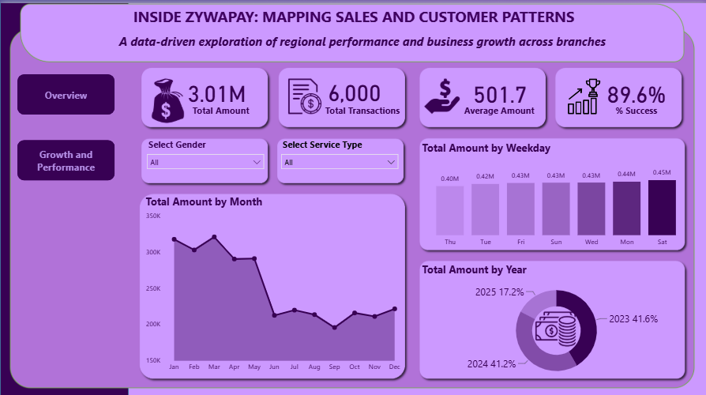
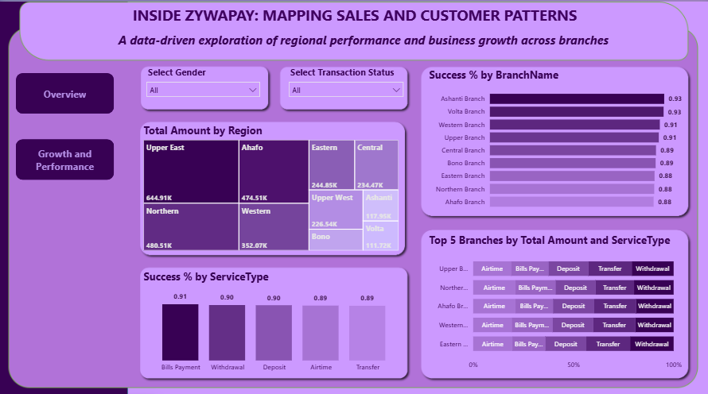

# Inside ZywaPay: Mapping Sales and Customer Patterns
### A data-driven exploration of regional performance and business growth across branches

#### About the Project

**Inside ZywaPay: Mapping Sales and Customer Patterns** is an interactive dashboard designed in Microsoft Power BI to explore transaction amounts, transaction success rates, regional performance and branch performance for ZywaPay, a mobile money and payments business.

The report has two pages. The **Overview** page looks at total amounts over time, by weekday and by year. The **Growth and Performance** page looks at regional sales, branch success rates and service type performance.

The project is an analytical and data visualisation exercise intended to demonstrate how transaction data can be transformed into meaningful, interactive insights. The underlying data is a practice dataset and as such, should be interpreted in the context of the project rather than as independently verified business results.

#### Project Objectives

The dashboard was created to explore five main questions:

1. How much was transacted overall, and what was the average transaction amount?
2. What proportion of transactions were successful?
3. How do transaction amounts change by month, weekday and year?
4. Which regions and branches contribute the most to total transaction amount?
5. Which branches and service types have the highest success rates?

#### Dashboard Preview

| Overview Page | Growth and Performance Page |
|---|---|
|  |  |

#### Dashboard Components

##### 1. Overview KPIs

The Overview page displays four key performance indicators (KPIs):

- **Total Amount:** 3.01M
- **Total Transactions:** 6,000
- **Average Amount:** 501.7
- **% Success:** 89.6%

##### 2. Total Amount by Month

The area chart tracks total amount from January through December, combining all years in the dataset.

Amounts are highest in the first five months of the year (peaking at about 321K in March), then they drop from June onwards. September is the lowest month at about 195K.

##### 3. Total Amount by Weekday

The column chart compares total amount across the days of the week:

- Saturday — 0.45M
- Monday — 0.44M
- Wednesday — 0.43M
- Sunday — 0.43M
- Friday — 0.43M
- Tuesday — 0.42M
- Thursday — 0.40M

##### 4. Total Amount by Year

The donut chart shows each year's share of total amount:

- 2023 — 41.6%
- 2024 — 41.2%
- 2025 — 17.2%

##### 5. Total Amount by Region

The treemap compares total amount across regions:

- Upper East — 644.91K
- Northern — 480.51K
- Ahafo — 474.51K
- Western — 352.07K
- Eastern — 244.85K
- Central — 234.47K
- Upper West — 226.54K
- Bono — 122.59K
- Ashanti — 117.95K
- Volta — 111.72K

##### 6. Success % by Branch Name

The bar chart compares the share of completed transactions across branches:

- Ashanti Branch — 0.93
- Volta Branch — 0.93
- Western Branch — 0.91
- Upper Branch — 0.91
- Central Branch — 0.89
- Bono Branch — 0.89
- Eastern Branch — 0.88
- Northern Branch — 0.88
- Ahafo Branch — 0.88

##### 7. Success % by Service Type

The column chart compares the success rate across the five service types:

- Bills Payment — 0.91
- Withdrawal — 0.90
- Deposit — 0.90
- Airtime — 0.89
- Transfer — 0.89

##### 8. Top 5 Branches by Total Amount and Service Type

The 100% stacked bar chart shows how the top five branches' total amount is split across Airtime, Bills Payment, Deposit, Transfer and Withdrawal. The five branches are Upper, Northern, Ahafo, Western and Eastern.

#### Key Insights

The dashboard provides several initial observations that can guide further analysis.

##### a. Regional Concentration

Upper East has the largest displayed total amount at 644.91K, which is about 21% of the overall total. Together with Northern and Ahafo, the top three regions account for about 53% of the total amount.

##### b. Success Rates

About 89.6% of transactions were completed successfully. Success rates are close across service types (0.89 to 0.91) and range from 0.88 to 0.93 across branches.

##### c. High Success, Lower Amounts

Ashanti and Volta have the highest branch success rates (0.93) but are among the regions with the lowest total amounts (117.95K and 111.72K).

##### d. Weekday Pattern

Saturday has the highest total amount (0.45M) and Thursday the lowest (0.40M), although the differences between days are small.

##### e. Monthly Pattern

Monthly amounts fall noticeably from June onwards. 

These observations are descriptive findings from the displayed dashboard. They do not, on their own, establish the causes of differences in performance or explain the underlying business conditions.

#### Tools Used

- **Microsoft Power BI** — Dashboard development, Data visualisation and Interactive reporting.
- **Power Query** — Data cleaning and Data transformation.
- **DAX** — Measures for Total Amount, Total Transactions, Average Amount and Success %.

#### Visualisations

The dashboard uses a combination of:

- KPI cards
- Area chart
- Column charts
- Horizontal bar charts
- Donut chart
- Treemap
- 100% stacked bar chart
- Interactive slicers
- Page navigation buttons

#### Interactive Features

The dashboard is designed to support interactive exploration rather than simply present static figures.

##### i. Filter by Gender

Use the Select Gender slicer to examine transactions by customer gender on both pages.

##### ii. Filter by Service Type

Use the Select Service Type slicer on the Overview page to explore a chosen service.

##### iii. Filter by Transaction Status

Use the Select Transaction Status slicer on the Growth and Performance page to view Completed, Pending or Failed transactions.

##### iv. Explore Time Trends

Use the month, weekday and year charts to see how amounts change over time.

##### v. Compare Regions and Branches

Use the treemap and branch charts to compare amounts and success rates across regions and branches.

##### vi. Navigate Between Pages

Use the **Overview** and **Growth and Performance** buttons to move between the two pages.

#### Live Dashboard
Kindly tap on the link below to explore and interact with the Live dashboard.

[https://app.powerbi.com/view?r=eyJrIjoiOWY2ZWFjMjEtMzg5ZC00YjQ0LTgzMzMtMzg3YmIwY2QzNDEzIiwidCI6IjEwNGQ4MDQ4LWZkMGMtNDNkNS1hNjMwLWZjNjI5ZTVkYWI1OSJ9]

#### Why This Dashboard?

Raw transaction logs contain deep operational stories that sometimes get lost in spreadsheets. **Inside ZywaPay** bridges this gap by unifying multi-dimensional data into a centralized, interactive visual report.
The dashboard empowers us to explore business performance across multiple dimensions:

• **Performance Drill-Downs**: Allow for easy shifting from macro-level overviews to micro-level analysis.

• **Multi-Dimensional Filters**: Help analyze data dynamically by Transaction Amounts, Success Rates, Regions, Branches, Service Types, and Time Trends.

• **Data-Driven Decisions**: Provides meaningful insights that uncover hidden patterns and reveal unanswered questions that warrant deeper exploration.

This repository demonstrates how Business Intelligence (BI) converts complex data architecture into meaningful insights that might just become business solutions.

#### Author:
#### Naa Akweley Marley
LinkedIn: [Naa Akweley Marley](https://www.linkedin.com/in/naa-akweley-marley)